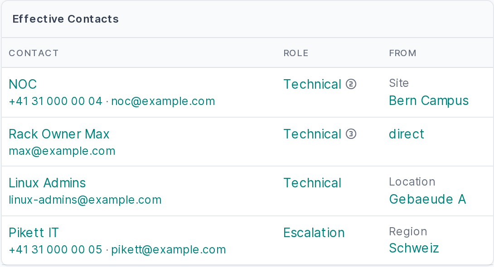
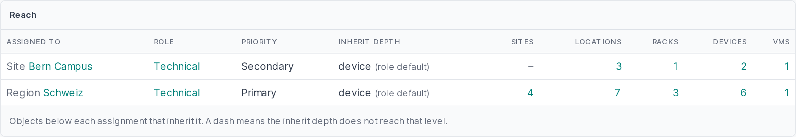
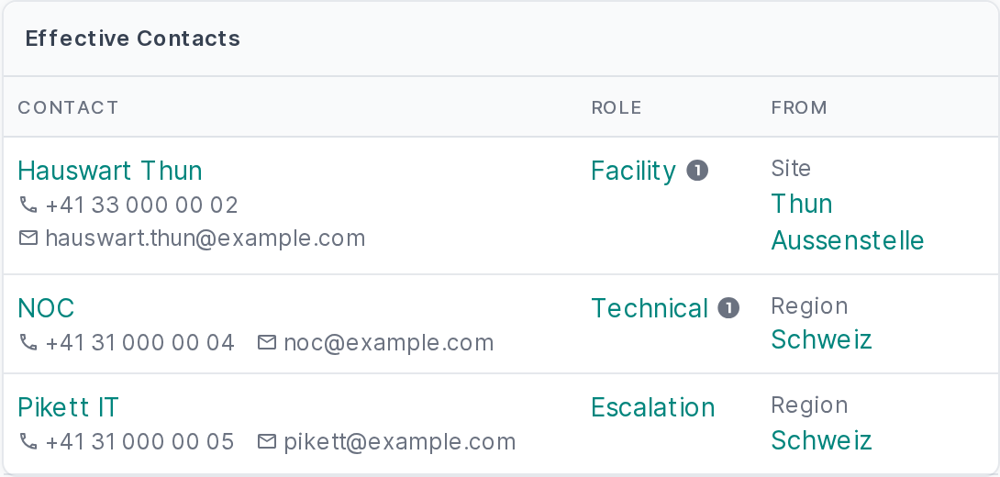
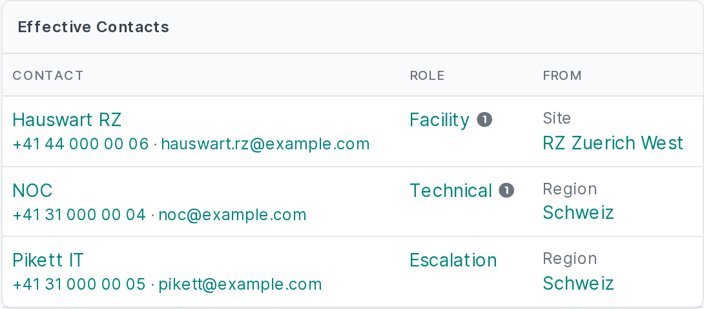

# netbox-contact-inheritance

NetBox plugin that shows contacts inherited from region, site group, site, location and rack on the
objects below them. A facility manager assigned to a region shows up on every site, location and rack
in it, and each entry tells where it is inherited from. You maintain one assignment instead of
thousands.

Status: **mock / proof of concept**. Read-only, it creates no models, and it uses only native
contact assignments plus one custom field.

## Why

NetBox attaches contacts to single objects. To see the responsible facility manager on a rack or a
device, the contact must be assigned to every rack and device. When that person leaves, every
assignment has to be changed. In practice people end up renaming the contact.

The idea has come up upstream several times, but NetBox does not offer it:

| Issue | Topic | Outcome |
|---|---|---|
| [#13087](https://github.com/netbox-community/netbox/issues/13087) | Inherit contacts from region/location to locations, racks and devices | closed, not planned (stale) |
| [#17050](https://github.com/netbox-community/netbox/issues/17050) | Assign contact groups to objects | closed with a pointer to *Object Owner* (v4.5), which models NetBox users and groups, not contacts with phone and role |
| [#21739](https://github.com/netbox-community/netbox/issues/21739) | Assign a contact group as a contact | rejected: "assign multiple contacts, or create one contact for the team" |
| [#11307](https://github.com/netbox-community/netbox/issues/11307) | Bulk import of contact assignments | done; it eases mass assignment but does not remove it |
| [#23672](https://github.com/netbox-community/netbox/pull/23672) | Bulk add and remove of contacts in bulk edit | merged; same: more assignments, faster |

Related discussions: [#8359](https://github.com/netbox-community/netbox/discussions/8359),
[#9088](https://github.com/netbox-community/netbox/discussions/9088),
[#15064](https://github.com/netbox-community/netbox/discussions/15064).

NetBox itself inherits contacts only inside one nested model: a location's contacts tab includes
those of its parent locations (`ContactsMixin.get_contacts(inherited=True)`). This does not cross
models, so contacts do not pass from a site to a location, from a location to a rack, or from a rack
to a device.

## What it does




- An **Effective Contacts** panel on site, location, rack, device and virtual machine pages. It lists
  the object's own contacts plus the inherited ones, with the object each one comes from.
- A **Reach** panel on contact pages: per assignment, how many sites, locations, racks, devices and
  VMs below the assigned object inherit it. Each count links to the regular NetBox list filtered to
  exactly those objects. When someone leaves, you see at a glance what depends on them.
- **Circuits:** the panel on circuits shows the circuit's own contacts and those of its provider. Below
  that comes one block per termination side (A, Z) with the contacts of the location or site the
  termination is attached to, plus those of the devices cabled to it. The cable path is traced through
  patch panels, and such entries are marked "via cable". A circuit termination page shows its own
  side. Provider contacts reach the circuits unless their inherit depth is `none`.
- A read-only API endpoint with the effective contacts of an object:

  ```
  GET /api/plugins/contact-inheritance/effective-contacts/?object_type=dcim.device&object_id=123
  ```

  Each result holds the assignment, the full contact, role, priority, `inherited`, the applied
  `inherit_depth` and the `source` object (type, id, level, distance). For `circuits.circuit` and
  `circuits.circuittermination`, each result also has a `section` (`circuit`, `A`, `Z`) and `via`
  (the cabled device, or null).



### Inheritance path

```
Region (and parents) ─┐
Site Group (and parents) ─┴─ Site ── Location (and parents) ── Rack ── Device
                              └──────────────────────────────────── Virtual Machine
```

If the same contact has the same role on several levels, only the nearest assignment is shown.

### Inherit depth

Not every contact belongs on every device. A facility manager is useful on a building or a room. At a
small site, though, the facility manager may also be the person who restarts the server. How far an
assignment reaches is set with the select custom field `inherit_depth` (`none`, `site`, `location`,
`rack`, `device`):

1. on the **contact assignment**: overrides the role default for this one assignment
2. on the **contact role**: default for all assignments with this role
3. otherwise the plugin setting `default_depth` (default `device`)

Example (as in the dev seed): the role *Facility* defaults to `site`, so the regional facility manager
shows on the sites only. The caretaker of a datacenter gets `location`: building, floors and rooms,
but the racks belong to IT. The electrician of a building gets `rack`. At a small branch site the
caretaker also restarts the server and gets `device`.

The Circuits column of the reach panel counts circuits for provider assignments only. Virtual circuits
are not supported yet.

`location` covers all nested location levels. "Down to the floor but not the rooms" is not possible.

Direct assignments always show. `none` means "only on the object itself".

| Small site: caretaker with depth `device` | Datacenter room: caretaker with depth `location` |
|---|---|
|  |  |

The panel sits in the right column of the detail page, see the [full device page](docs/device-page.png).

## Install

```
pip install netbox-contact-inheritance
```

```python
PLUGINS = ["netbox_contact_inheritance"]
PLUGINS_CONFIG = {
    "netbox_contact_inheritance": {
        "depth_field": "inherit_depth",  # name of the custom field
        "default_depth": "device",
    },
}
```

Run `manage.py migrate` (netbox-docker does it on start). The plugin's migration creates the select
custom field `inherit_depth` on *Tenancy > Contact Role* and *Tenancy > Contact Assignment*, with the
choices `none`, `site`, `location`, `rack` and `device`. If a field of that name already exists, it is
kept and only the two object types are added. Uninstalling leaves the field in place.

Requires NetBox 4.6.5 or later.

## Development

```
cd dev
docker compose up -d     # http://localhost:8011, admin / admin, seeded hierarchy and contacts
docker compose exec netbox sh -c "/opt/netbox/venv/bin/python /opt/netbox/netbox/manage.py shell < /demo/smoke.py"
uvx pytest tests         # inheritance rules, no NetBox needed
```

Code changes need `docker compose up -d --force-recreate netbox`. The seed builds Schweiz › Bern with a
campus (building, floor, room, rack) and a small branch site, plus contacts on several levels. The
smoke test checks the effective contacts per object, the panel, the API and permissions, then rolls
back.
